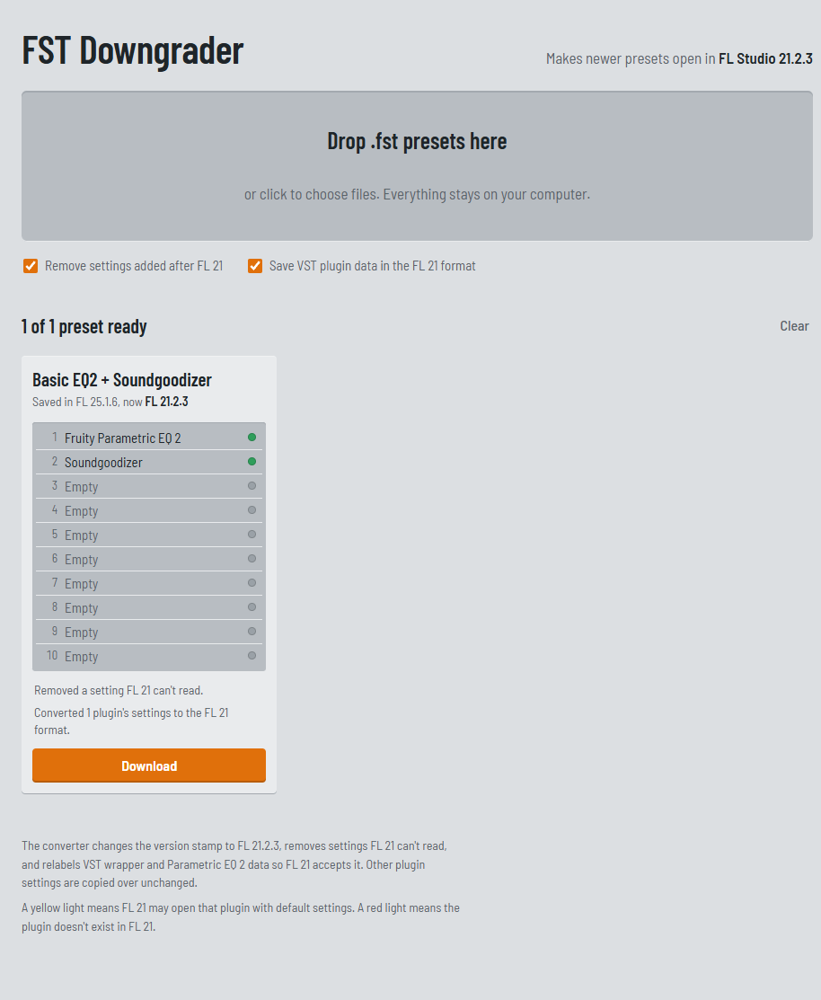

# FST Downgrader

[](https://github.com/cryst4lpepsi/fst-downgrader/actions/workflows/test.yml)

Open FL Studio 24 and 25 presets (`.fst`) in **FL Studio 21.2.3**.

FL Studio refuses presets saved in a newer version, or loads them and then fails with "Project file contains invalid data". This tool rewrites the preset so FL 21 accepts it. It's the preset equivalent of project (`.flp`) downgraders.

**[Use it in your browser](https://cryst4lpepsi.github.io/fst-downgrader/)**: drop presets on the page and download the converted files. Everything runs locally; nothing is uploaded.



## Supported versions

Presets from any version newer than 21.2.3 are converted: the FL 24 betas (21.2.99, 24.0.99), FL 2024 (24.x) and FL 2025 (25.x). Presets from 21.2.3 or older already open in FL 21 and are left unchanged.

Checked so far:

| Saved in | How |
|---|---|
| 25.1.6 | Converted presets opened in FL 21.2.3, including three Parametric EQ 2s |
| 24.0.99, 24.1.0, 24.1.2, 21.2.99 | FL 2024's factory presets convert cleanly; plugins new in FL 24 (Spreader, Low Lifter, Transporter, Kepler Exo) are flagged |

If a preset from another version doesn't load in FL 21, please open an issue and attach it.

## Command line

Convert whole preset folders at once (needs [Node.js](https://nodejs.org) 18 or newer):

```
npx github:cryst4lpepsi/fst-downgrader "D:\My presets" --out "D:\Presets for FL21"
```

Folders are searched recursively and the folder structure is kept. Originals are never changed. Presets that already open in FL 21 are copied as they are, so the output folder is a complete set.

| Option | |
|---|---|
| `-o, --out <folder>` | Where to write the presets (default: `./FL21`) |
| `-n, --dry-run` | Show what would happen without writing anything |
| `--keep-unknown` | Don't remove settings added after FL 21 |
| `--keep-wrapper` | Don't convert VST plugin data to the FL 21 format |

## What it changes

- Sets the version to `21.2.3.4004`, the build FL 21.2.3 writes.
- Removes data fields FL 21 doesn't know about. For example, event 169 was added in FL 24, and FL 21 reports "invalid data" when it sees it.
- Relabels Fruity Wrapper (VST) settings from v12 to v10 when every chunk in them is one FL 21 knows.
- Relabels Parametric EQ 2 settings from v8 (FL 24+) to v7. The layout is identical, but FL 21 crashes on the v8 label.

Plugins that don't exist in FL 21 are flagged, and their slot will be empty. Other plugins whose settings were saved in a newer format get a warning: they may open with default settings.

## How it works

An `.fst` file has the same structure as an `.flp` project: an `FLhd` header (format, channel count, PPQ) followed by an `FLdt` chunk containing a stream of events. Each event is a one-byte ID followed by a value whose size depends on the ID:

| Event ID | Value |
|---|---|
| 0–63 | 1 byte |
| 64–127 | 2 bytes |
| 128–191 | 4 bytes |
| 192–255 | variable-length size, then that many bytes |

The events that matter here:

| ID | Meaning |
|---|---|
| 199 | Version string, e.g. `25.1.6.4997` |
| 159 | Build number |
| 169 | Added in FL 24; FL 21 rejects it |
| 201 | Plugin internal name (UTF-16) |
| 203 | Plugin display name |
| 213 | Plugin settings; the first 4 bytes are that plugin's own format version |
| 98 | Mixer slot index; a slot's plugin events come before it |

To find what FL 21.2.3 understands, every preset shipped with FL 21 and its factory content (about 8,600 files) was scanned for the event IDs, plugin names and plugin settings versions it writes. These lists are built into `src/fst-core.js`. Anything newer is removed, relabelled when the layout is known to match, or flagged.

## Development

- `src/fst-core.js`: the converter. It has no dependencies and works in the browser and in Node.
- `index.html`: the web app.
- `cli.js`: the command-line tool.
- `test/`: tests. They build their presets from scratch (`test/presets.js`), so the repo contains no one else's presets.

```
npm test
```

Converting to versions other than FL 21.2.3 (FL 20, FL 24) is planned. Each needs its own scan of the presets that version writes.

## License

[MIT](LICENSE). FL Studio is a trademark of Image-Line. This project isn't affiliated with Image-Line.
